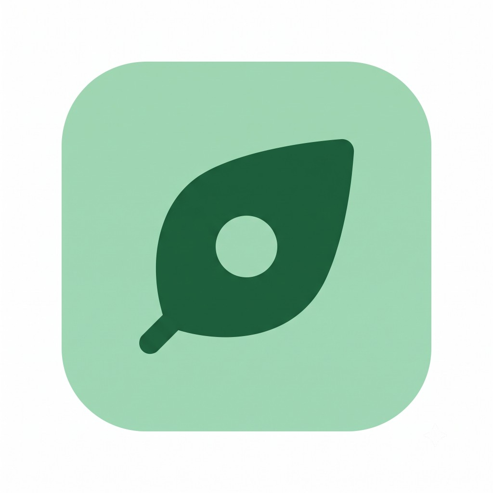
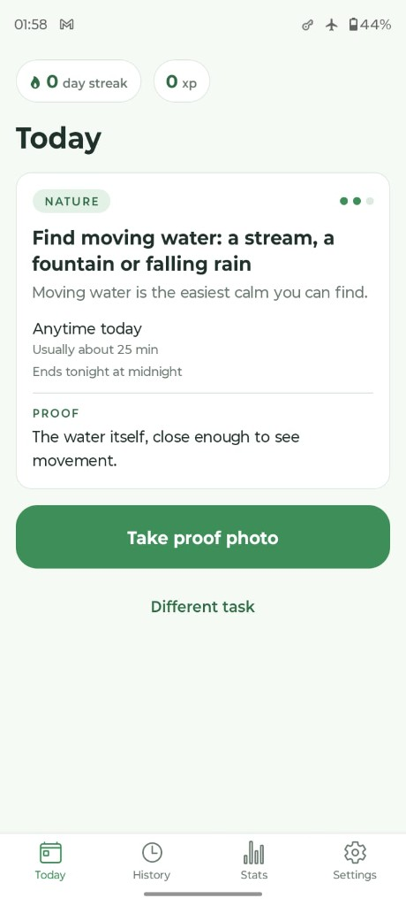
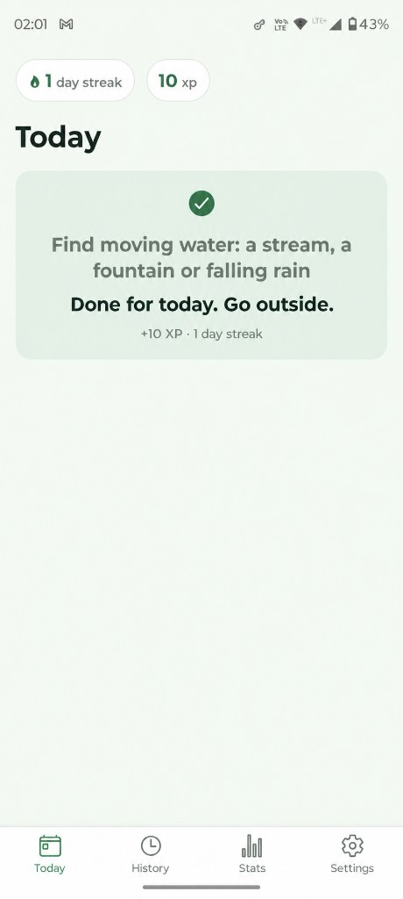

# Touch Grass

<p align="center">
  
</p>

Single-user app that gives you one daily outdoor task (nature, movement, exploration, social, creative, community). You submit a live photo as proof from a mobile app; a laptop server verifies it with a local VLM served by Ollama.

See `AGENTS.md` for the full spec, hard rules and game/verdict rules.

## Prerequisites

- [uv](https://docs.astral.sh/uv/) (Python package manager)
- Python 3.11+
- Node.js 20+ (for the Expo app in `app/`)
- [Ollama](https://ollama.com) running locally with a vision model:
  ```bash
  ollama pull qwen2.5vl:3b
  ```
- Git
- Optional: [Tailscale](https://tailscale.com) so the phone can reach the laptop over HTTPS-grade WireGuard while the app still uses HTTP
- Optional: an [Expo](https://expo.dev) account if you want a standalone APK (`eas build`)

## Setup

```bash
# 1. Install dependencies (creates .venv and uv.lock)
uv sync

# 2. Configure environment
copy .env.example .env   # Windows; use `cp .env.example .env` on macOS/Linux
# Edit .env and set API_TOKEN to a long random string. Never commit .env.

# 3. Mobile app (first clone)
cd app
npm install
```

## Run the server

From the repo root:

```bash
uv run uvicorn server.main:app --host 0.0.0.0 --port 8000
```

Health check (no auth needed):

```bash
curl http://localhost:8000/health
```

All other endpoints require `Authorization: Bearer <API_TOKEN>`.

The server starts its own background worker: pending submissions are verified
in order, one at a time, keeping the model on a single Ollama request.

### Seed a few days of history

To see streaks/XP without waiting, backfill fake completed days (skips a day
at offset 5 to show streak gaps):

```bash
uv run python scripts/fake_days.py --days 20
```

Refuses to touch a non-empty database unless you pass `--force`. Use `--db`
to point at a copy.

### Reset today's submissions (dev)

Deletes today's submissions and their image files so you can re-test the day's
task. The task itself, its reroll flag and other days are left alone.

```bash
uv run python scripts/reset_today.py
```

Pass `--yes` to skip the confirm prompt.

### Try it end to end (real VLM)

With the server running and Ollama up, run the demo client — it fetches
today's task, submits a photo, polls until the worker finishes, then prints
the verdict, evidence and stats:

```bash
uv run python scripts/demo.py spike/photos/outdoor.jpeg
```

Pass `--base`, `--token` and `--tz` to override the `.env`/environment
values. Exit code 0 only when the photo is verified.

### The API

| Method | Path | Purpose |
|---|---|---|
| GET | `/health` | Liveness + model name (no auth) |
| GET | `/tasks?from=YYYY-MM-DD&days=N` | Daily tasks (display fields only — the rubric never leaves the server). Each task includes `day_ends_at` (UTC ISO of next local midnight in TIMEZONE). |
| GET | `/preferences` | Effective task preferences plus `is_default` |
| PUT | `/preferences` | Partial update; regenerates future tasks with no submissions |
| POST | `/preferences/reset` | Delete the stored row (back to defaults) |
| POST | `/tasks/{id}/reroll` | One free reroll per day, today only |
| POST | `/submissions` | Multipart: `task_id`, `client_submission_id`, `captured_at`, optional `lat`/`lon`/`note`, `image` file. Idempotent per client id (201 first time, 200 on repeat) |
| GET | `/submissions/{id}` | Status, verdict, hint, VLM evidence, honor availability |
| POST | `/submissions/{id}/honor` | "Mark done anyway", once per task |
| GET | `/stats` | XP, level, streaks, month count, 30-day calendar | 
| GET | `/history?limit&offset` | Past submissions with titles + thumbnails |
| GET | `/images/{id}?thumb=1` | The stored proof photo |

Status codes: `401` bad/missing token · `404` unknown id · `400` invalid
capture · `409` rule conflicts (rerolled already, already honored, …).

## Tests

```bash
uv run pytest
```

## Offline evaluation

`eval/` replays a batch of photos through the full verification pipeline
(quality gate -> duplicate check -> VLM rubric -> verdict) and reports how
often the engine disagrees with your expectations.

1. Drop photos into `eval/photos/` (gitignored).
2. Edit `eval/cases.json` — one entry per photo:

   ```json
   {
     "file": "garden.jpg",
     "rubric": {
       "criteria": [
         { "id": "leaves", "question": "Are the leaves yellow, orange or red?", "required": true }
       ]
     },
     "expected": "pass"
   }
   ```

   - `file`: filename inside `eval/photos/`.
   - `rubric.criteria`: `{id, question, required}`. `required: false` criteria
     are logged only and never affect the verdict.
   - Alternatively, skip the inline rubric and use a real task library entry:
     `"template_id": "nat_leaf_hunt"` (the `task_id` then defaults to that id).
   - `expected`: one of `pass`, `fail`, `retake`, `rejected`.
      - `retake` needs a blurry/dark/too-small photo (the VLM is skipped).
      - `rejected` needs a photo whose hash already appears under a *different*
        `task_id`. Entries are processed in order against a running hash list;
        the default task id is `task-<position>`, override with an optional
        `"task_id"` field per entry (see the placeholder in `cases.json`).
   - Cases run sequentially with `temperature 0`, so runs are mostly repeatable.
3. With Ollama running:

   ```bash
   uv run python -m eval.run_eval
   ```

Output: false-reject rate (expected pass, split into fail/unsure/retake/
rejected), false-accept rate, unsure rate, average seconds per image, and a
table of every mismatch with the hint and the model's evidence.

Verify a single real photo against one task (full production pipeline):

```bash
uv run python -m eval.verify_photo --template nat_leaf_hunt --photo path/to/photo.jpg
```

## Task library

All daily tasks live in `server/tasks/library.yaml` — hand-written, never
generated (AGENTS.md rule 6). The loader validates it loudly: unique ids,
2-4 criteria with at least 2 required, yes/no phrasing, safety scan, social
tasks need comfort + note prompt, and each category must keep at least its
minimum count (`server/tasks/library.py`).

- Check the library after editing it:

  ```bash
  uv run pytest tests/test_library.py
  ```

- Preview what the picker would choose for the next days:

  ```bash
  uv run python -m server.tasks.preview --days 14
  ```

  Optional: `--start 2026-06-01`, `--seed other` (changes the picks).

- The daily pick is deterministic (`server/tasks/picker.py`): player
  preferences (category often/normal/rarely/never, social comfort, longest
  task) weight the draw; no template repeats within 14 days; no category
  repeats two days running; one free reroll per day excludes the current
  task. Change preferences in the app under **Settings → Your tasks**.
  Changes apply from tomorrow; a reroll uses them immediately.

## Mobile app

The phone client lives in `app/` (Expo SDK 57, expo-router, TypeScript,
package `com.dagger.touchgrass`). It shows today's task, takes a live proof
photo, shows the verdict, and has History, Stats and Settings tabs. A task is
"anytime today": the whole local day counts, with a gentle "Ends tonight at
midnight" note after 6 pm if it isn't done. Today refreshes itself when the
date rolls over.

Run it with the server up and the phone on the same network (or Tailscale):

```bash
cd app
npm install
npx expo start
```

Scan the QR code with **Expo Go** (Android/iOS), or install a standalone APK
(below). Then in the app:

1. **Settings** tab → open **Connection** if it is collapsed, set Server
   address (main) to `http://<laptop-ip>:8000` (e.g. your Tailscale IP) and
   the API token. Server 2 is an optional backup (e.g. LAN IP).
2. Tap **Test connection** — it should read *Connected to qwen2.5vl:3b*.
   **Your tasks** (at the top) sets how often each category appears, social
   comfort and the longest task. Offline those controls are read-only.
3. **Today** shows the day's task ("Anytime today"):

   

   Tap **Take proof photo**:
   - Live camera only (no gallery or image picker). Default lens is the back
     camera; a flip button switches front/back for this app session (next
     launch is back again). Front-camera proofs are not mirrored. Camera
     permission is required; location is optional and never blocks capture.
     Flip and shutter are disabled while a photo is being taken.
   - Preview with **Retake** / **Use this photo**. The photo is resized to
     max 1280px wide, JPEG 0.8, then uploaded.
   - "Checking your photo..." polls the server every 3 seconds; you can put
     the phone away.
   - Result: pass shows XP and streak; fail/unsure/retake show the hint and
     evidence with **Retake** and **Mark done anyway (half XP)**; rejected
     (matches an earlier photo) offers the same.
   - After the task is done, Today shows one completed card (soft green,
     check, dimmed title): "Done for today. Go outside." plus
     "+N XP · N day streak". Honor completions say "Marked done (half XP)"
     instead. The camera button is hidden. Settings is the Settings tab
     only (no gear overlay).

     
4. **History** groups submissions by local day: one row per day with the
   final outcome (pass / honor / not done), the task title and the best
   attempt's thumbnail. Tap a row to see each attempt. **Stats** shows
   streaks, XP and level, tasks this month, the last 30 days, category bars,
   and local screen time (today + 7-day average) as an honesty metric.

### Offline-first

The app works without a connection to your laptop:

- **Today** reads tasks cached on the phone (today + the next 3 days). If
  nothing is cached yet it says "Open the app once while connected to your
  server."
- Photos taken offline are copied to the app's document folder and queued in a
  local SQLite database. Today shows "Saved. I'll check it when I can reach
  your laptop.", counts the task as *provisionally done* (dotted flame on the
  streak preview) and a **Waiting to sync (N)** pill appears.
- A sync runs on app open, when returning to the foreground, when the network
  changes, and every 60 s while the app is open. Uploads are idempotent
  (`client_submission_id`), so a retry never creates a duplicate. Network
  errors and timeouts retry with backoff (max 5 min).
- A token mismatch (HTTP 401) stops syncing and asks you to check Settings. A
  server rejection such as a capture on the wrong day marks the item failed
  with the server's message and is never retried.
- Queued items live under that day's History row ("Counts for <capture date>"
  and a status chip). Tapping the day expands the attempts.
- When the verdict arrives: pass confirms the day; fail/unsure/retake show the
  hint with **Retake** and **Mark done anyway (half XP)** (queued and sent
  later if you are offline). Rerolling needs a connection and is disabled
  offline.
- The local photo is deleted only after a final verdict and a server
  thumbnail exist.
- **Stats** and **History** keep the last server response on the phone. When
  the server is unreachable they show those values with a small "Last updated
  <time>, offline" label instead of an error.

#### Manual test script

1. Open the app online once so tasks are cached.
2. Turn on airplane mode. Take a photo for today's task. You should see the
   "Saved" message.
3. Force-close and reopen the app (still offline): the item is still queued.
4. Turn airplane mode off. Within ~60 s the photo uploads and a verdict
   arrives.
5. Repeat with the laptop server stopped (phone online): the app stays calm
   and retries.
6. Toggle the network on and off quickly: confirm the server shows exactly one
   submission.

Checks: `cd app && npx tsc --noEmit` and `npx eslint src`.

### Build an Android APK

Standalone install (package `com.dagger.touchgrass`) so you do not need Expo Go. The build allows HTTP to your laptop over Tailscale (already encrypted); it is not meant for cleartext on the public internet.

```bash
npm i -g eas-cli
cd app
eas login
eas build --profile preview --platform android
```

The `preview` profile in `app/eas.json` produces an APK (`distribution: internal`). Expo config is `app/app.config.ts` (Android cleartext + iOS ATS for Tailscale HTTP). Install the APK, then set the server URL and token in **Settings**. Log real outdoor runs in `docs/FIELD_TEST.md`.

## Project layout

```
server/    FastAPI app (main, config, db, worker, verify/, tasks/, game/)
eval/      Offline evaluation cases + photos (photos/ gitignored)
spike/     Throwaway experiments (photos/ gitignored)
tests/     Unit tests
scripts/   Helper scripts (demo, fake_days, reset_today)
data/      SQLite DB + uploaded images (gitignored)
app/       Expo mobile app (app.config.ts, eas.json)
docs/      Logo, screenshots, field-test log template
```

## Notes

- Photos never leave the machine; they are stored only under `data/images/`.
- The VLM only answers rubric questions — pass/fail verdicts are plain Python logic in `server/verify/verdict.py`.
- The app never sends photos anywhere except your own server.
